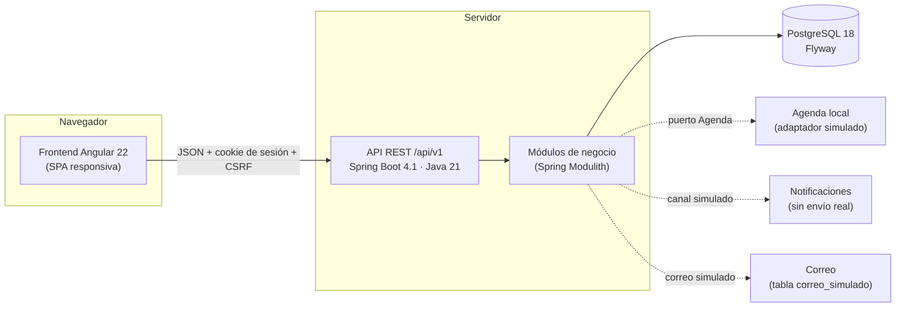
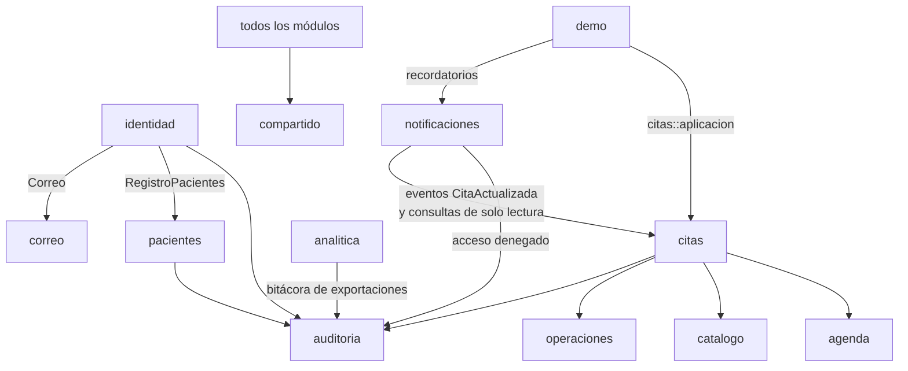
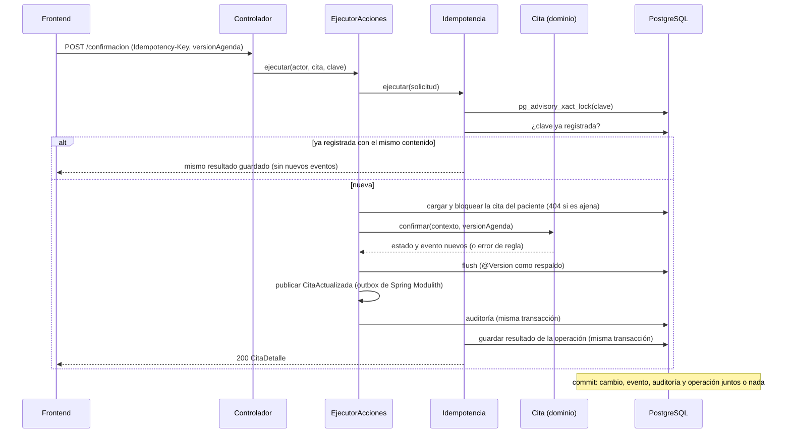

# Arquitectura de SIGA-SP

## Resumen

SIGA-SP es un **monolito modular** (apartado 3.4 del documento del proyecto) con tres partes:

| Decisión | Elección | Motivo |
|---|---|---|
| Estilo | Monolito modular con fronteras verificadas | Menos complejidad operativa que microservicios. `ModularidadTest` falla si un módulo usa clases internas de otro o si hay ciclos (RNF16). |
| Backend | Spring Boot 4.1.1, Java 21, Spring Modulith 2.1 | Es el stack del documento. Las versiones son estables y vigentes a octubre de 2026. |
| Frontend | Angular 22 (standalone, signals) | Es el stack del documento (figura 3). |
| BD | PostgreSQL 18 con migraciones Flyway versionadas | Integridad declarativa: claves foráneas, CHECK, UNIQUE, exclusión diferible y triggers (RNF07). |
| Sesión | Sesión de servidor con cookie HttpOnly y SameSite=Lax | Cerrar sesión la invalida en el servidor (HU01 c.3), cosa que un JWT sin estado no garantiza. |
| CSRF | Cookie `XSRF-TOKEN` y cabecera `X-XSRF-TOKEN` | Angular lo soporta de forma nativa. |
| Errores | Problem Details (RFC 9457) con `codigo` estable | El frontend decide por el código y no por el texto (ver `docs/api.md`). |
| Integraciones | Puertos con adaptadores simulados | Agenda y notificaciones se pueden sustituir sin tocar las reglas del dominio (PB28). |

## Módulos

Cada paquete de primer nivel bajo `pe.edu.utp.sigasp` es un módulo. Su paquete base es la API pública; los subpaquetes (`interno`, `web`, `dominio`, `persistencia`) son privados del módulo.

| Módulo (paquete) | Módulo del documento | Responsabilidad | Estado |
|---|---|---|---|
| `compartido` | — | Errores, actor actual, reloj, Request-Id y tareas programadas. Es abierto y no depende de nadie. | Listo |
| `identidad` | M1 Identidad y acceso | Login, logout, sesión, CSRF, roles y bloqueo por intentos. v1.1: registro de pacientes, recuperación y cambio de contraseña, y revalidación de la sesión en cada solicitud. | Listo |
| `pacientes` | M1 (perfil) | Perfil no clínico (HU21) y alta de la ficha (`RegistroPacientes`, que usa el registro de cuentas). | Listo |
| `correo` | — | Correo saliente simulado: `Correo.enviar(destinatario, asunto, cuerpo, enlace)` registra en `correo_simulado` y lo indica en el log. Solo con `sigasp.dev.buzon-correos=true` (perfil dev) guarda el cuerpo y el enlace y existe el buzón `GET /dev/correos`; en producción guarda solo el asunto y el destinatario enmascarado. | Listo (v1.1) |
| `catalogo` | — | Motivos y catálogos de atención (`CatalogoAtencion`: sedes, especialidades y profesionales). | Listo |
| `agenda` | M9 Integración | Puerto `Agenda` y su adaptador local con reserva atómica. | Listo |
| `citas` | M2 Gestión de citas, M3 Pre-atención, M4 Llegada y turno | Máquina de estados, versiones de agenda, línea de tiempo, casos de uso del paciente y del operador, y cierre por inasistencia. | Listo (S1–S3) |
| `operaciones` | — | Idempotencia y consulta de operaciones con respuesta perdida. | Listo |
| `notificaciones` | M5 Notificaciones | Recordatorio de 24 h y avisos de cambio (también de la reserva), ambos simulados, y centro de notificaciones del paciente (`BandejaPaciente`). | Listo |
| `auditoria` | M8 Administración y auditoría | Bitácora de solo inserción (`Auditoria`) y su consulta paginada con filtros (`ConsultaBitacora`, `GET /admin/auditoria`, solo ADMINISTRADOR y solo lectura). | Listo (v1.1, PB25) |
| `seguimiento` | M6 Seguimiento | Encuesta posterior a la atención (S4). | La tabla existe |
| `analitica` | M7 Analítica operativa | Indicadores reproducibles al corte t (`Indicadores`, apartado 13.5) en una sola consulta SQL, y exportación CSV (`GET /analitica/resumen` y `resumen.csv`, RESPONSABLE y ADMINISTRADOR). | Listo (v1.1, PB20–PB24) |
| `demo` | — | Datos sintéticos de demostración (perfil `dev`). | Listo |

Dependencias entre módulos (Spring Modulith verifica que no haya ciclos ni accesos a paquetes internos de otro módulo):

`ModularidadTest` genera también los diagramas oficiales de módulos en `backend/target/spring-modulith-docs/`.

## Capas dentro del módulo `citas`

| Capa | Paquete | Contenido |
|---|---|---|
| Dominio | `citas.dominio` | `Cita` (agregado raíz), `VersionAgenda`, `EventoCita` (inmutable), `PreCheckIn`, `RegistroLlegada` y `ReglasTiempo`. Sin servicios ni repositorios de Spring: solo anotaciones JPA y el catálogo de errores compartido (`CodigoError`, que incluye el estado HTTP). |
| Aplicación | `citas.aplicacion` | Casos de uso (`ServicioCitasPaciente`, `ServicioReservas`, `ServicioAtencionOperador`, `RegistroCitas`, `CierreInasistencias`), el `EjecutorAcciones` (plantilla común, también para dar de alta una cita), los códigos `SP-AAAA-NNNNNN` (`CodigosCita`) y las vistas. |
| Persistencia | `citas.persistencia` | Repositorio JPA del agregado y modelo de lectura en SQL (`ConsultasCitas`). |
| Web | `citas.web` | Controladores REST, validación de entrada y cabecera `Idempotency-Key`. |

**Una sola fuente de verdad para las reglas.** `Cita.impedimento(accion, actor, ahora, reglas)` decide si una acción está permitida. Ese mismo método:

1. se ejecuta antes de cada cambio, de modo que si la regla falla la cita queda intacta;
2. calcula `accionesPermitidas`, que es lo que el frontend usa para mostrar botones.

Ocultar un botón nunca reemplaza el control del servidor (regla 1 del apartado 3.3.1).

## Flujo de una acción que cambia una cita

Después del commit, `notificaciones` recibe `CitaActualizada` (en `@ApplicationModuleListener`, con su propia transacción). Un fallo del envío simulado no revierte la gestión de la cita (regla 6 del apartado 3.3.1). Los eventos que no se completan se reintentan cada 5 minutos (`ReintentoEventos`) y al reiniciar el servidor; los oyentes son idempotentes.

## Mecanismos transversales

### Seguridad (OWASP ASVS como guía)
- **Contraseñas**: BCrypt con sal mediante `DelegatingPasswordEncoder`. El prefijo `{bcrypt}` permite migrar de algoritmo (RNF01). BCrypt solo procesa 72 bytes: las contraseñas más largas (la política admite 128 caracteres) se guardan como `{bcrypt-sha256}` (BCrypt sobre el SHA-256 en base64). Política: de 10 a 128 caracteres, letra y número, distinta del correo y fuera de la lista local `seguridad/contrasenas-comunes.txt`.
- **Invalidación de sesiones (v1.1)**: por **versión de credenciales**, sin depender de ningún reloj. El principal guarda la `usuario.version_credenciales` con la que inició sesión; cambiar o restablecer la contraseña la incrementa, y el filtro `RevalidacionSesion` (justo después de cargar el contexto de seguridad) invalida en el servidor toda sesión con una versión anterior: la solicitud sigue como anónima y las rutas protegidas responden 401. El cambio de contraseña conserva la sesión actual (identificador nuevo, con la versión nueva). `credenciales_cambiadas_en` queda solo como dato informativo (hora real). Para no consultar la BD en cada solicitud, la versión vigente por usuario se guarda en una caché en memoria que solo avanza (se llena al iniciar sesión y al cambiar la contraseña); como el bloqueo por intentos, supone una sola instancia.
- **Recuperación (v1.1)**: token aleatorio de 32 bytes (base64url); solo se guarda su SHA-256, vence a los 30 minutos de hora real y es de un solo uso (restablecer invalida todos los pendientes del usuario). Con un correo de formato válido, la solicitud responde 202 exista o no la cuenta. El enlace absoluto del correo usa `sigasp.correo.url-base` o, si no está definida, el origen de la solicitud. El correo simulado solo guarda el cuerpo y el enlace (que llevan el token) con el buzón de desarrollo; el log nunca los incluye.
- **Límites por origen (v1.1)**: registro, 5 por hora por IP; recuperación, 5 cada 15 minutos por correo y por IP (429 con `Retry-After`; el perfil dev los sube a 100 porque con `ng serve` todo llega desde 127.0.0.1). Ventana deslizante en memoria, atómica por clave y con memoria acotada. La IP es la que resuelve Spring según `server.forward-headers-strategy`: sin estrategia, la dirección de la conexión; con `native`, la de `X-Forwarded-For` solo si la conexión viene de un proxy de confianza (redes internas), así que un cliente directo no puede falsificarla. Detrás de un proxy inverso la estrategia es obligatoria (`despliegue.md`).
- **Rutas de desarrollo**: `/api/v1/dev/reloj` (con `sigasp.reloj.ajustable=true`) y `/api/v1/dev/correos` (con `sigasp.dev.buzon-correos=true`) solo existen en el perfil dev. Cualquier otra ruta `/api/v1/dev/**`, o todas en producción, responde 404 a todos, con o sin sesión y antes de CSRF y del rol (`RutasDesarrolloInexistentes`).
- **Sesión**: se cambia el identificador al iniciar sesión (contra la fijación de sesión). Expira tras 30 minutos de inactividad. El logout la invalida y borra la cookie.
- **Bloqueo**: 5 intentos en 15 minutos (hora real) bloquean la cuenta 15 minutos. Cada intento se reserva de forma atómica antes de verificar la contraseña, así que las solicitudes en paralelo no pueden superar el límite. El login siempre responde el mismo 401 genérico; el cambio de contraseña, cuya persona ya está autenticada, responde 429 `DEMASIADOS_INTENTOS` con `Retry-After` mientras dura el bloqueo. El registro vive en memoria, con purga de entradas vencidas; si hubiera varias instancias, habría que llevarlo a la BD. Riesgo aceptado: quien conozca un correo puede mantener esa cuenta bloqueada (ver `decisiones-pendientes-po.md`).
- **Autorización** en dos niveles:
  - por ruta y rol, con lista blanca (`anyRequest().denyAll()`);
  - por propiedad del recurso en los servicios: la cita del paciente o los profesionales asignados al operador.

  Una cita ajena responde igual que una inexistente (404) y se audita como `DENEGADO`. Las denegaciones de ruta se auditan cuando hay un usuario identificado; las solicitudes anónimas rechazadas (por ejemplo, sin CSRF) solo van al log, para que una ráfaga anónima no pueda llenar la bitácora.
- **Cabeceras**: `X-Frame-Options: DENY`, `Referrer-Policy: no-referrer`, `X-Content-Type-Options` y, con HTTPS, HSTS.
- **Errores**: nunca exponen trazas, SQL ni datos de terceros. El detalle técnico queda en el log con el `requestId`. También 405, 406 y 415 responden con su código correcto.

### Concurrencia e idempotencia
- **Bloqueo de fila al modificar** (`SELECT … FOR UPDATE`): dos cambios simultáneos sobre la misma cita se serializan. El segundo evalúa las reglas con el estado ya confirmado y responde 422 o 409 `VERSION_OBSOLETA`, nunca un error interno. `@Version` en `cita` se mantiene como respaldo optimista. Si PostgreSQL detecta un interbloqueo, o un candado no puede obtenerse, la API responde 409 `CONFLICTO_CONCURRENTE` sin guardar nada.
- **Versión de agenda**: el paciente envía la versión que vio. Si cambió, recibe 409 `VERSION_OBSOLETA`.
- **Reserva de horario**: un `UPDATE … WHERE cita_id IS NULL` es atómico y, junto con `UNIQUE(cita_id)`, impide la doble reserva. Las reservas nuevas de un mismo paciente se serializan con un candado consultivo por paciente, para que dos simultáneas no superen juntas los límites.
- **Idempotencia**: la tabla `operacion` guarda el resultado de cada clave en la misma transacción que el cambio. Si una clave no está registrada, se puede reintentar sin riesgo. Esto resuelve la "respuesta perdida" de la regla 5 del apartado 3.3.1. La huella del contenido se calcula con las claves ordenadas, así que no cambia entre reinicios del servidor.
- **Una conexión por solicitud**: los rechazos de negocio y los accesos denegados se registran **después** de que la transacción principal terminó y liberó su conexión. Así ninguna solicitud retiene dos conexiones a la vez y una ráfaga de rechazos no puede agotar el pool (prueba `RegresionRevisionIntegracionTest`).

### Tiempo
- Todo el código usa un `java.time.Clock` inyectado. El **reloj de negocio** (el `Clock` principal) es, en los perfiles `dev` y de pruebas, un `RelojAjustable`, que permite simular la hora mediante `PUT /api/v1/dev/reloj`.
- El **reloj de seguridad** (bean `relojSeguridad`, calificador `@RelojSeguridad`) es siempre la hora real (`Clock.systemUTC()`): lo usan el bloqueo por intentos, los límites de registro y recuperación y la vigencia de los enlaces de recuperación. Simular la hora de negocio no levanta un bloqueo ni mantiene vivo un enlace vencido. Las pruebas lo sustituyen por un reloj ajustable propio (`PruebaIntegracion.relojSeguridad`).
- Se guardan instantes UTC (`TIMESTAMPTZ`). Los textos y el "mismo día local" se calculan en `America/Lima`.

### Auditoría y trazabilidad
- La tabla `auditoria` es de solo inserción: un trigger rechaza UPDATE y DELETE. La línea de tiempo (`cita_evento`) tiene la misma protección.
- Cada evento de la cita guarda actor, instante del servidor, estado anterior y nuevo, versión de agenda, motivo y `operacion_id` (la clave de idempotencia). Con eso se pueden correlacionar la línea de tiempo, la auditoría y la operación (S2-R06).
- Limitación declarada: el trigger no protege frente a un administrador de la BD ni frente a `TRUNCATE`. En producción conviene revocar esos privilegios al usuario de la aplicación.

### Observabilidad
- Cada respuesta lleva `X-Request-Id`, que también se incluye en los logs (MDC) y en los errores (RNF15).
- Actuator expone solo `health` e `info`, sin detalles sensibles.

## Perfiles de configuración

| Perfil | Uso | Diferencias |
|---|---|---|
| (por defecto) | Producción o servidor | La conexión a la BD llega por variables de entorno `SIGASP_DB_*` (RNF19). Cookie `Secure`. Sin Swagger, sin datos demo, reloj real. |
| `dev` | Desarrollo local | BD en `localhost:5433` (`scripts/db.sh`). Incluye datos demo, Swagger UI, reloj simulable y logs DEBUG. |
| `test` | Pruebas automáticas | PostgreSQL embebido. Las tareas programadas están desactivadas (se invocan de forma explícita), el reloj de negocio es fijo y el de seguridad, ajustable por cada prueba. |

## Estrategia de pruebas

| Nivel | Dónde | Qué verifica |
|---|---|---|
| Unidad de dominio | `backend/src/test/.../citas/dominio/CitaTest.java` | Cada transición, bordes exactos de las ventanas, versiones, invalidaciones y actores. |
| Modularidad | `ModularidadTest` | Fronteras entre módulos y ausencia de ciclos; genera la documentación de módulos. |
| Integración | `backend/src/test/.../integracion/` y `demo/` | Casos S1-R01…S2-R08 de la Sprint Review con la API y la BD reales (S1-R06 en `DatosDemoIntegracionTest`): seguridad, concurrencia, idempotencia, notificaciones, integridad y regresiones de la revisión de código. |
| Frontend | `frontend/src/**/*.spec.ts` | Servicios (sesión, errores, idempotencia), guardas, pipes y componentes clave. |

Todo se ejecuta con `./mvnw test` y `npm test`, sin Docker ni servicios externos.
