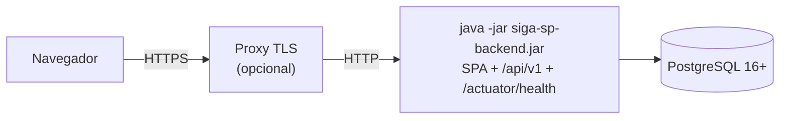

# Despliegue de SIGA-SP (jar único)

En producción, un solo proceso de Spring Boot sirve **el SPA de Angular y la API en el mismo origen**. El build del frontend va dentro del jar (`classpath:/static`). No hace falta CORS, Nginx ni un servidor de archivos aparte. La cookie de sesión y la de CSRF funcionan igual que en desarrollo.



## 1. Construir el jar

Requisitos: Java 21, Node (la versión que exige Angular 22, ver README) y npm.

```bash
scripts/construir-produccion.sh                # npm ci + ng build + ./mvnw -Pcon-frontend clean package
scripts/construir-produccion.sh --sin-pruebas  # igual, sin las pruebas del backend
```

El resultado es `backend/target/siga-sp-backend-<versión>.jar`. El script termina con error si el build de Angular no produce `index.html` o si el jar no lo contiene.

Pasos equivalentes a mano:

```bash
cd frontend && npm ci && npx ng build          # salida: frontend/dist/frontend/browser
cd ../backend && ./mvnw -Pcon-frontend clean package
```

- El perfil Maven `con-frontend` copia `../frontend/dist/frontend/browser/**` a `target/classes/static` en la fase `prepare-package` y antes borra un `static/` anterior, para que el jar no arrastre bundles de builds viejos.
- Las pruebas corren antes de esa fase, así que solo ven los recursos de prueba de `src/test/resources/static`, que nunca se empaquetan.
- La ruta del build sale de `angular.json`: el builder `@angular/build:application` no define `outputPath`, así que usa `dist/<proyecto>/browser`. Si alguien la cambia, se pasa con `-Dfrontend.dist=<ruta>`.
- Sin el perfil (`./mvnw package`), el jar solo trae la API. Así se usa en desarrollo, con `ng serve` y su proxy.

## 2. Ejecutar

```bash
export SIGASP_DB_URL=jdbc:postgresql://db.interna:5432/siga_sp
export SIGASP_DB_USER=siga
export SIGASP_DB_PASSWORD='…'          # desde el gestor de secretos, nunca en el repositorio
java -XX:MaxRAMPercentage=75 -jar siga-sp-backend-0.0.1-SNAPSHOT.jar
```

- Al arrancar, Flyway aplica las migraciones pendientes.
- El log confirma el modo con `SPA empaquetado: las rutas de navegación se responden con /index.html`. Si en su lugar dice `Sin SPA en classpath:/static`, el jar se construyó sin el perfil `con-frontend`.
- Estado del servicio: `GET /actuator/health` responde `{"status":"UP"}`, sin detalles y sin sesión.

### Variables de entorno

| Variable | Obligatoria | Uso |
|---|---|---|
| `SIGASP_DB_URL` | Sí | URL JDBC de PostgreSQL. |
| `SIGASP_DB_USER` / `SIGASP_DB_PASSWORD` | Sí | Credenciales de la BD (RNF19: los secretos solo llegan por el entorno). |
| `SERVER_PORT` | No | Puerto HTTP. Por defecto, 8080. |
| `SERVER_FORWARDHEADERSSTRATEGY` | **Sí, detrás de un proxy inverso** | `native`. Es **obligatoria** si un proxy (o balanceador) recibe las conexiones y envía `X-Forwarded-For`/`X-Forwarded-Proto`. Sin ella, todos los clientes comparten la IP del proxy: los límites por IP de registro y recuperación (5 por hora y 5 cada 15 minutos) se agotan entre todas las personas a la vez, y cualquier registro de la IP (por ejemplo, el log de accesos de Tomcat) vería solo la del proxy. Además, Spring no sabe que la conexión original es HTTPS y no envía HSTS. Con `native`, Tomcat solo acepta esas cabeceras si la conexión viene de una red interna (proxy de confianza); un cliente directo no puede falsificar su IP. Sin proxy, no se define. |
| `SIGASP_CORREO_URLBASE` | Recomendada | Origen público de la aplicación (por ejemplo, `https://citas.ejemplo.pe`) para el enlace absoluto de los correos de recuperación. Si no se define, se deduce del origen de la solicitud, que depende de la cabecera `Host` (y de `X-Forwarded-Host` detrás del proxy). |
| `SIGASP_PRIVACIDAD_VERSION` | No | Versión vigente de la política de privacidad (por defecto, `1.0`). Se guarda con cada cuenta nueva (`paciente.privacidad_version`); cámbiala al publicar una política nueva. |
| `SPRING_PROFILES_ACTIVE` | No | En producción se deja **vacío** (ver perfiles). |
| `JAVA_TOOL_OPTIONS` | No | Opciones de la JVM, como memoria o zona horaria del log. La lógica de negocio usa `America/Lima` (`sigasp.reglas.zona-horaria`) sin importar la zona del servidor. |

### Perfiles

| Perfil | Cuándo | Qué cambia |
|---|---|---|
| *(ninguno)* | **Producción** | Cookie `Secure`, sin Swagger, sin datos demo, reloj real y tareas programadas activas. `/api/v1/dev/**` responde 404 a todos y el correo simulado guarda solo el asunto y el destinatario enmascarado. |
| `dev` | Solo en local | BD de `scripts/db.sh`, datos demo, reloj de negocio ajustable (`/api/v1/dev/reloj`), buzón del correo simulado (`/api/v1/dev/correos`, que guarda los enlaces con su token), límites de registro y recuperación en 100 (con `ng serve` todo llega desde 127.0.0.1), Swagger y cookie sin `Secure`. **Nunca en producción.** |
| `test` | Pruebas automáticas | PostgreSQL embebido y tareas programadas apagadas. |

La cookie de sesión es `Secure`, así que el navegador solo la envía por HTTPS. La excepción es `http://localhost`, que los navegadores tratan como origen seguro. En un servidor real hace falta TLS, propio o en el proxy.

## 3. Rutas: SPA, archivos y API

| Solicitud | Respuesta |
|---|---|
| `GET /api/**` | La API, con las reglas de `docs/api.md`. Nunca se reenvía al SPA. |
| `GET /actuator/health`, `/actuator/info` | Públicos; el resto del actuator no se expone. |
| `GET` o `HEAD` de un archivo del build (`/main-….js`, `/styles-….css`, `/media/…`, `/favicon.ico`, `/index.html`) | Público, sin sesión. Si el archivo no existe: 404 `RECURSO_NO_ENCONTRADO`. |
| `GET` o `HEAD` de una **navegación del SPA**: ruta sin extensión cuyo `Accept` incluye `text/html` (`/login`, `/inicio`, `/paciente/**`, `/operador/**`, `/acceso-denegado` y cualquier otra) | Reenvío interno a `/index.html` (200). El enrutador de Angular resuelve la vista, también la de «página no encontrada». |
| Cualquier otra cosa (otros métodos, extensiones ajenas como `.php`, `/webjars/**`, rutas sin `text/html`) | Denegada: 401 sin sesión y 403 con sesión. |

Un `fetch` o un `curl` sin `Accept: text/html` no recibe el `index.html`. Se exige `text/html` de forma explícita (`*/*` no basta) para que un cliente de la API nunca reciba HTML por error.

## 4. Cabeceras

### Seguridad

| Cabecera | Valor | Dónde |
|---|---|---|
| `Content-Security-Policy` | `default-src 'self'; script-src 'self' 'sha256-…'; style-src 'self' 'unsafe-inline'; img-src 'self' data:; font-src 'self'; connect-src 'self'; frame-ancestors 'none'; base-uri 'self'; form-action 'self'; object-src 'none'` | Solo en respuestas `text/html` (el `index.html`) |
| `Permissions-Policy` | `camera=(), microphone=(), geolocation=(), payment=(), usb=(), browsing-topics=()` | Todas |
| `Cross-Origin-Opener-Policy` | `same-origin` | Todas |
| `X-Frame-Options` | `DENY` | Todas |
| `X-Content-Type-Options` | `nosniff` | Todas |
| `Referrer-Policy` | `no-referrer` | Todas |
| `Strict-Transport-Security` | `max-age=31536000 ; includeSubDomains` | Solo por HTTPS (ver `SERVER_FORWARDHEADERSSTRATEGY`) |
| `X-Request-Id` | Identificador de la solicitud | Todas |

Notas sobre la CSP:

- **`style-src 'unsafe-inline'`**: Angular inyecta los estilos de los componentes en etiquetas `<style>`, y el `index.html` lleva el CSS crítico en línea.
- **`script-src` no admite scripts en línea.** La única excepción es el script que agrega el build de producción para activar la hoja de estilos diferida (`<link media="print" data-beasties-media>`, por la inserción de CSS crítico). Se permite solo por su **hash SHA-256**, que el backend calcula al arrancar a partir del `index.html` empaquetado. No hay que mantener hashes a mano, y si Angular cambia ese script en una versión futura, el hash se recalcula solo.
  - Si se desactiva la inserción de CSS crítico (`optimization.styles.inlineCritical: false`), no queda ningún script en línea y la política es exactamente la base.
- **Prohibido en el frontend**: manejadores en línea (`onclick=`, `onload=`), `eval`/`new Function`, y scripts, fuentes, imágenes o API de otros orígenes (CDN incluidos). Las fuentes deben estar alojadas en el proyecto (`font-src 'self'`). Las imágenes pueden ser del propio origen o `data:`; los SVG en línea dentro de las plantillas no cuentan como recursos.

### Caché HTTP

| Recurso | `Cache-Control` | Revalidación |
|---|---|---|
| Archivos con hash del build: `main-*.js`, `chunk-*.js`, `polyfills-*.js`, `scripts-*.js`, `worker-*.js`, `styles-*.css`, `media/**` | `max-age=31536000, public, immutable` | Nunca: un cambio de contenido cambia el nombre (`outputHashing: all`). |
| `index.html` y rutas del SPA | `no-cache` | En cada visita, con un **ETag débil** del contenido (`W/"…"`). Si no cambió, la respuesta es 304. |
| Otros archivos sin hash (`favicon.ico`, archivos de `public/`) | `no-cache` | Igual que `index.html`. |
| API | `no-cache, no-store, max-age=0, must-revalidate` y `Pragma: no-cache` | No se guarda. |
| `GET /api/v1/catalogos/motivos` | `max-age=300, private` | Solo el navegador lo guarda, 5 minutos (exige sesión, así que nunca se guarda en un proxy). |

Por qué no se usa `Last-Modified`: el jar de Spring Boot es reproducible y fija la fecha de todas sus entradas en 1980-02-01. Con `If-Modified-Since`, un `index.html` viejo recibiría 304 después de un despliegue y apuntaría a bundles que ya no existen. El ETag sale del contenido, así que cambia en cuanto cambia el archivo. Es débil (`W/`) porque Tomcat no comprime respuestas con ETag fuerte.

### Compresión

Tomcat comprime con gzip (`server.compression` en `application.yml`):

- **Tipos**: `text/html`, `text/css`, `text/javascript`, `application/javascript`, `application/json`, `application/problem+json`, `image/svg+xml`, `text/plain`, `application/manifest+json` e iconos.
- **Umbral**: 1 KB (por debajo, comprimir no compensa).
- **Sin recomprimir**: las fuentes `woff2` (ya vienen comprimidas) y las imágenes rasterizadas.
- **Caché**: la compresión conserva `Cache-Control` y agrega `Vary: accept-encoding`, para que una caché intermedia no entregue la versión gzip a un cliente que no la acepta.

Referencia con el build actual: `main-*.js` pasa de 116,7 kB a 34,3 kB y `styles-*.css` de 8,0 kB a 2,4 kB. Si hay un proxy delante, puede comprimir con Brotli; en ese caso se desactiva la compresión de Tomcat (`SERVER_COMPRESSION_ENABLED=false`) para no comprimir dos veces.

## 5. Verificar con curl

```bash
B=http://localhost:8080
NAV='Accept: text/html,application/xhtml+xml,*/*;q=0.8'

# Respaldo del SPA: una ruta de Angular devuelve index.html con no-cache, ETag y CSP
curl -s -D - -o /dev/null -H "$NAV" $B/paciente/citas

# gzip en el HTML (debe mostrar Content-Encoding: gzip y Vary: accept-encoding)
curl -s -D - -o /dev/null -H "$NAV" -H 'Accept-Encoding: gzip' $B/login | grep -iE 'content-encoding|vary|cache-control'

# Bundle con hash: inmutable y comprimido; la compresión no quita Cache-Control
MAIN=$(curl -s $B/index.html | grep -o 'main-[A-Za-z0-9_-]*\.js')
curl -s -D - -o /dev/null -H 'Accept-Encoding: gzip' $B/$MAIN | grep -iE 'cache-control|content-encoding|vary'

# Ahorro de la compresión (bytes sin y con gzip)
curl -s $B/$MAIN | wc -c; curl -s -H 'Accept-Encoding: gzip' $B/$MAIN | wc -c

# Revalidación: con el ETag vigente la respuesta es 304
ETAG=$(curl -s -D - -o /dev/null -H "$NAV" $B/inicio | awk -F': ' 'tolower($1)=="etag"{print $2}' | tr -d '\r')
curl -s -o /dev/null -w '%{http_code}\n' -H "$NAV" -H "If-None-Match: $ETAG" $B/inicio      # 304

# La API no se reenvía ni se cachea (401 en JSON, no-store, sin CSP)
curl -s -D - -H "$NAV" $B/api/v1/pacientes/me/citas

# Sin text/html explícito no hay reenvío
curl -s -o /dev/null -w '%{http_code}\n' $B/paciente/citas                                    # 401

# Catálogo de motivos (requiere sesión): private, max-age=300
curl -s -c c.txt -b c.txt $B/api/v1/auth/csrf > /dev/null
XSRF=$(awk '$6=="XSRF-TOKEN"{print $7}' c.txt)
curl -s -c c.txt -b c.txt -H "X-XSRF-TOKEN: $XSRF" -H 'Content-Type: application/json' \
     -d '{"email":"<correo>","password":"<clave>"}' $B/api/v1/auth/login > /dev/null
curl -s -D - -o /dev/null -b c.txt "$B/api/v1/catalogos/motivos?tipo=CANCELACION" | grep -i cache-control
rm c.txt
```

Si el servidor solo es accesible por HTTPS, la cookie `Secure` exige usar `https://` en `B`.

## 6. Rendimiento de la API

- **Panel del operador sin N+1.** Antes, `GET /operador/citas` hacía una consulta por cita para la llegada (uno a uno inverso, que Hibernate no puede cargar de forma perezosa) y otra por cita para sus versiones de agenda: con 20 citas eran 24 sentencias. Ahora son 4, con 4 citas o con 20:
  1. el modelo de lectura;
  2. las citas con su llegada (`left join fetch`);
  3. las versiones por lote;
  4. los eventos por lote, solo si alguna cita está En atención.
- **Lotes.** `hibernate.default_batch_fetch_size: 64` inicializa las colecciones perezosas de todas las citas de la sesión con una sola sentencia `… where cita_id = any (?)`.
- **Detalle y línea de tiempo del paciente**: 5 y 3 sentencias como máximo, sin importar cuánto historial tenga la cita. Cada motivo se consulta una sola vez por solicitud.
- **Prueba.** `ConsultasSqlIntegracionTest` lo comprueba: cuenta todas las sentencias (Hibernate y JDBC) del hilo de la solicitud con `ContadorSentencias` y falla si el número crece con las citas o supera el tope.

## 7. Problemas frecuentes

| Síntoma | Causa probable |
|---|---|
| La página carga sin estilos y la consola muestra «Refused to execute inline script» | Algo distinto del build modificó el HTML (por ejemplo, un proxy que inyecta scripts). La CSP solo admite los scripts en línea del `index.html` empaquetado, cuyo hash se calcula al arrancar. |
| Al recargar `/paciente/citas` aparece 401 en JSON | El cliente no envió `Accept: text/html` (por ejemplo, un `fetch`). Los navegadores siempre lo envían al navegar. |
| Toda ruta del SPA responde 404 | El jar no incluye el frontend (falta `-Pcon-frontend`); el log de arranque lo indica. |
| Tras un despliegue, el navegador pide un `chunk-….js` que no existe | Un proxy guarda `index.html` sin respetar `no-cache`. Configúralo para que respete el `Cache-Control` del origen. |
| La sesión no se mantiene al probar el jar por `http://` en otra máquina | La cookie de sesión es `Secure`: usa HTTPS (o `http://localhost`). |
| No aparece `Strict-Transport-Security` detrás del proxy | Falta `SERVER_FORWARDHEADERSSTRATEGY=native`, o el proxy no envía `X-Forwarded-Proto: https`. |
| Crear cuenta o recuperar la contraseña responde 429 a muchas personas distintas a la vez | Falta `SERVER_FORWARDHEADERSSTRATEGY=native` detrás del proxy (todas comparten su IP), o el proxy no está en una red interna: entonces hay que declarar su IP en `SERVER_TOMCAT_REMOTEIP_INTERNALPROXIES`. |
