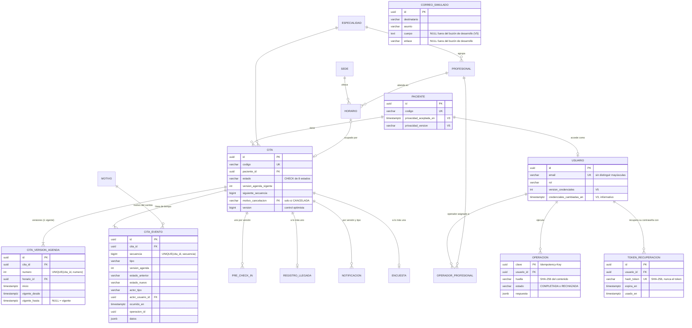

# Modelo de datos (lógico y físico)

El esquema base está en `backend/src/main/resources/db/migration/V1__esquema_base.sql` y las migraciones siguientes lo amplían (ver [Migraciones](#migraciones)); esta página explica sus decisiones. Este modelo completa lo que el documento del proyecto dejaba pendiente (tabla 8: "modelo conceptual, lógico y físico") y corrige los vacíos que detectó la revisión del documento.

## Tablas y restricciones clave

| Tabla | Propósito | Restricciones que protegen una regla |
|---|---|---|
| `usuario` | Cuentas de acceso | `email` único sin distinguir mayúsculas. `CHECK`: PACIENTE ⇔ `paciente_id` no nulo. `rol` ∈ {PACIENTE, OPERADOR, RESPONSABLE, ADMINISTRADOR}. `version_credenciales ≥ 0` (V5): cambiar o restablecer la contraseña la incrementa y las sesiones abiertas con una versión anterior dejan de valer. |
| `paciente` | Ficha no clínica del paciente | `codigo` único. Desde V3, `privacidad_aceptada_en`; desde V5, `privacidad_version` (versión de la política aceptada al registrarse, de `sigasp.privacidad.version`). |
| `token_recuperacion` | Enlaces de restablecimiento de contraseña (V3) | Solo el hash SHA-256 del token, `UNIQUE`. `CHECK (expira_en > creado_en)`. Un solo uso (`usado_en`). |
| `correo_simulado` | Canal de correo simulado (V3) | Nada sale del sistema. `cuerpo` y `enlace` solo se guardan con el buzón de desarrollo activo (`sigasp.dev.buzon-correos`); fuera de él quedan en NULL y el destinatario se guarda enmascarado (V5). |
| `operador_profesional` | Citas "asignadas" al operador (HU02 c.2, HU10) | PK compuesta. |
| `horario` | Agenda local (adaptador de M9) | `UNIQUE(profesional_id, inicio)`. `UNIQUE(cita_id)`: una cita ocupa un solo horario. La reserva es un UPDATE condicional (`cita_id IS NULL`). |
| `cita` | Agregado raíz | `codigo` único con el formato `SP-AAAA-NNNNNN`, numerado por la secuencia `cita_codigo_seq` (V3). `CHECK` de los 8 estados. `CHECK`: CANCELADA ⇔ hay motivo. Columna `version` para el control optimista. |
| `cita_version_agenda` | Horario conocido en cada intervalo | `UNIQUE(cita_id, numero)`. **Exclusión diferible**: una sola versión con `vigente_hasta IS NULL` por cita. |
| `cita_evento` | Línea de tiempo | `UNIQUE(cita_id, secuencia)` (desempate ante instantes iguales). Inmutable por trigger. |
| `pre_check_in` | Datos previos por versión | `UNIQUE(cita_id, version_agenda)`. `invalidado_en` se marca al reprogramar. |
| `registro_llegada` | Presencia | `UNIQUE(cita_id)`: la llegada no se duplica (HU10 c.3). |
| `notificacion` | Recordatorios y avisos simulados | `UNIQUE(cita_id, version_agenda, tipo, ventana)`: reprocesar no duplica (HU08 c.3). `leida_en` (V3) para el centro de notificaciones del paciente. |
| `encuesta` | Satisfacción (S4) | `UNIQUE(cita_id)` y `CHECK` de calificación entre 1 y 5. |
| `operacion` | Idempotencia | PK = clave del cliente; guarda la huella y la respuesta. |
| `auditoria` | Bitácora | Solo inserción (trigger). Índices por tiempo, actor y entidad (V1) y por acción y resultado en el orden de la vista (V4). |
| `event_publication` | Outbox de Spring Modulith | Esquema oficial v2. |

## Migraciones

| Migración | Qué agrega |
|---|---|
| `V1__esquema_base.sql` | Esquema del MVP: catálogos, personas, agenda, citas con versiones y eventos, pre-check-in, llegada, notificaciones, encuesta, operaciones, auditoría y el outbox de Spring Modulith. |
| `V2__catalogo_motivos.sql` | Motivos de cancelación y reprogramación. |
| `V3__cuenta_reserva_notificaciones.sql` | **v1.1, cuenta y reserva.** Secuencia `cita_codigo_seq` (códigos `SP-AAAA-NNNNNN`). `notificacion.leida_en` e índice `ix_notificacion_cita (cita_id, creada_en DESC)`. `paciente.privacidad_aceptada_en`. `usuario.credenciales_cambiadas_en`. Tabla `token_recuperacion` (hash SHA-256 único, vigencia y uso, índice por usuario y fecha). Tabla `correo_simulado` (índice por `enviado_en DESC`). `especialidad.descripcion` y `sede.direccion` (hasta 200 caracteres). |
| `V4__indices_analitica.sql` | **v1.1, indicadores y bitácora.** Solo índices, sin cambios de datos: `ix_version_inicio_corte` sobre `cita_version_agenda (inicio)` con `INCLUDE` de cita, número, vigencia, sede y profesional (cubre también las versiones ya cerradas, que necesita un corte histórico); `ix_evento_cita_corte` sobre `cita_evento (cita_id, ocurrido_en)` con `INCLUDE` de secuencia, tipo, versión y estado nuevo; `ix_auditoria_accion_orden (accion, ocurrido_en DESC, id DESC)` e `ix_auditoria_resultado_orden (resultado, ocurrido_en DESC, id DESC)`. |
| `V5__credenciales_y_consentimiento.sql` | **v1.1, revisión de seguridad.** `usuario.version_credenciales INTEGER NOT NULL DEFAULT 0` con `CHECK (≥ 0)`: las sesiones se invalidan por versión, no por instante, así que no dependen del reloj (que en desarrollo se puede simular); `credenciales_cambiadas_en` queda como dato informativo. `paciente.privacidad_version VARCHAR(20)`: versión de la política de privacidad aceptada. `correo_simulado.cuerpo` admite NULL: fuera del buzón de desarrollo no se guardan el cuerpo ni el enlace, que llevan el token. |

La reserva no necesitó tablas nuevas: las reglas de límite y de solapamiento consultan `cita` y su versión vigente en `cita_version_agenda` (índice `ix_cita_paciente`), y la ocupación del horario sigue siendo el UPDATE condicional sobre `horario`.

## Vacíos del modelo original que esta versión resuelve

| Hallazgo de la revisión | Solución en el esquema |
|---|---|
| La figura 4 no tenía Sede, Usuario/Rol, PreCheckIn ni RegistroLlegada | Son tablas propias con claves foráneas. |
| No había dónde guardar la idempotencia | La tabla `operacion` guarda clave, huella, estado y respuesta, y la operación se correlaciona con `cita_evento.operacion_id`. |
| Los indicadores "al corte" no podían reconstruirse | `cita_evento.version_agenda` + `secuencia` + `ocurrido_en`, y la vigencia de cada versión (`vigente_desde`/`vigente_hasta`), permiten reconstruir el estado y el horario en cualquier instante t. |
| Faltaba la unidad de ocupación de la agenda | `horario` con ocupación atómica. |
| La vigencia de la versión no estaba definida | `vigente_desde` y `vigente_hasta`, más la restricción de una sola vigente. |
| Los eventos simultáneos no tenían desempate | `secuencia` monotónica por cita. |
| La integridad de la auditoría no estaba definida | Triggers de solo inserción en `auditoria` y `cita_evento`. |

## Convenciones
- **Identificadores**: UUID generados por la aplicación. En los datos de demostración se derivan de un nombre (son deterministas), para que la carga sea idempotente.
- **Tiempo**: `TIMESTAMPTZ` en UTC. En el MVP de una sola sede, la zona de visualización se configura en `sigasp.reglas.zona-horaria` (America/Lima). La columna `sede.zona_horaria` queda preparada para varias sedes, pero el código aún no la lee.
- **Datos personales**: solo sintéticos. `paciente` guarda nombres y contacto, nunca datos clínicos. La auditoría de un cambio de perfil guarda los nombres de los campos, no los valores. La bitácora de un login o registro fallido guarda solo el dominio del correo.
- **Secretos**: las contraseñas se guardan con hash (`bcrypt`, o `bcrypt-sha256` si superan 72 bytes) y los tokens de recuperación solo como hash SHA-256.
- **Migraciones**: siempre una versión nueva, la siguiente es `V6__…`. Nunca se edita una migración ya aplicada.
