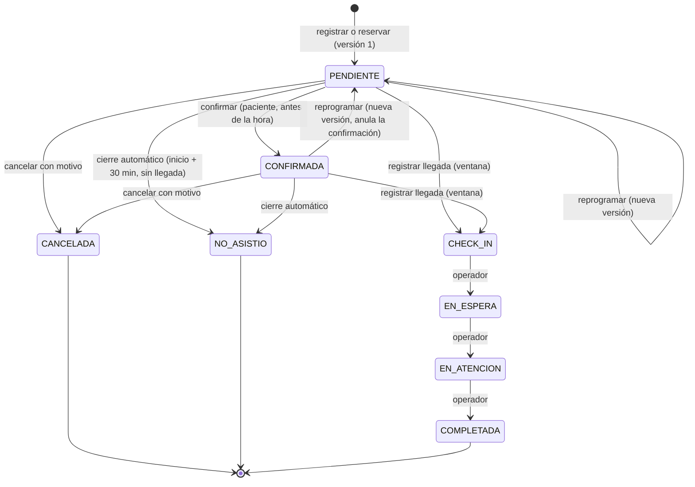

# Reglas del dominio implementadas

Fuente: apartados 3.3.1 y 3.3.2, tabla 7 y HU04–HU12 del documento del proyecto. Las reglas viven en `backend/.../citas/dominio/Cita.java` y están cubiertas por `CitaTest`.

## Máquina de estados

## Acciones, actores y condiciones

| Acción | Actor | Estado de origen | Condición de tiempo | Efecto |
|---|---|---|---|---|
| Confirmar | Paciente propietario | PENDIENTE | `ahora < inicio` | CONFIRMADA. La confirmación queda ligada a la versión vigente. |
| Cancelar | Paciente propietario | PENDIENTE o CONFIRMADA | `ahora < inicio` | CANCELADA (terminal). El motivo es obligatorio y debe ser de tipo CANCELACION. Libera el horario. |
| Reprogramar | Paciente propietario | PENDIENTE o CONFIRMADA | `ahora < inicio` y nuevo inicio futuro | Mismo ID. Cierra la versión vigente y crea N+1, vuelve a PENDIENTE, anula la confirmación e invalida el pre-check-in y los recordatorios pendientes de la versión anterior. El motivo es obligatorio (tipo REPROGRAMACION). |
| Pre-check-in | Paciente propietario | PENDIENTE o CONFIRMADA, sin pre-check-in vigente | `ahora < inicio` | No cambia el estado. No acredita presencia. |
| Registrar llegada | Paciente propietario u operador asignado | PENDIENTE o CONFIRMADA, sin llegada | `inicio − 60 min ≤ ahora < inicio + 30 min` y el mismo día local | CHECK_IN. No exige confirmación previa. |
| Pasar a espera | Operador asignado | CHECK_IN | — | EN_ESPERA |
| Iniciar atención | Operador asignado | EN_ESPERA | `ahora ≥ llegada` | EN_ATENCION |
| Completar | Operador asignado | EN_ATENCION | `ahora ≥ inicio de atención` | COMPLETADA (terminal) |
| Marcar No asistió | Sistema | PENDIENTE o CONFIRMADA, sin llegada | `ahora ≥ inicio + 30 min` | NO_ASISTIO (terminal). La tarea corre cada minuto. |

Validaciones comunes, en este orden:

1. Identidad y propiedad. Si fallan, se responde 404 sin revelar que la cita existe y se audita como DENEGADO.
2. Versión: `versionAgenda` para el paciente y `versionCita` para el operador. Si no es la vigente, 409.
3. Regla de la acción. Si falla, 422 `TRANSICION_NO_PERMITIDA` o `FUERA_DE_PLAZO`.

Un rechazo no modifica datos ni genera eventos de éxito; queda auditado como RECHAZO.

### Fronteras de tiempo (decisión documentada)
- La ventana de llegada es **semiabierta**: `[inicio − 60 min, inicio + 30 min)`. El instante `inicio + 30 min` ya no admite llegada y sí admite el cierre por inasistencia, así que las dos reglas nunca se solapan.
- "Mismo día local" se evalúa en `America/Lima`. Una cita a las 00:20 no admite llegada a las 23:40 del día anterior.
- Si la llegada y el cierre compiten en el mismo momento, ambas transacciones bloquean la fila de la cita (`SELECT … FOR UPDATE`): la segunda espera y vuelve a evaluar las reglas con el estado ya confirmado, así que solo una de las dos acciones se aplica. `@Version` queda como respaldo.

## Reserva de una cita nueva (v1.1)
`POST /pacientes/me/citas` (paciente, con `Idempotency-Key`) usa la misma plantilla que las demás acciones: idempotencia, evento `CREADA` (actor PACIENTE), auditoría `CITA_RESERVAR`, publicación de `CitaActualizada` y registro de rechazos. Responde 201 con la cita en PENDIENTE y versión 1. Código: `citas/aplicacion/ServicioReservas.java` y `citas/persistencia/ConsultasReserva.java`; pruebas en `ReservaCitasIntegracionTest`.

Reglas, en este orden:

1. **Especialidad coherente.** La especialidad existe y es la del profesional del horario. Si no, 400 `VALIDACION` con el campo `especialidadCodigo`.
2. **Horario reservable.** El horario existe, no ha empezado y empieza con la **anticipación mínima**: `inicio ≥ ahora + sigasp.reglas.anticipacion-reserva` (por defecto `PT2H`). Si no, 409 `HORARIO_NO_DISPONIBLE`, con un `detail` que dice desde qué fecha y hora se puede reservar. El borde se incluye: un horario que empieza justo en *ahora + 2 h* se puede reservar.
3. **Límites** (422 `LIMITE_CITAS`). Solo cuentan las citas **no terminales** del paciente (Pendiente, Confirmada, Llegada registrada, En espera o En atención) y, de cada una, su versión de agenda **vigente**. Una cita cancelada, completada, con inasistencia o el horario anterior de una cita reprogramada no cuentan. Se evalúan en este orden y el `detail` nombra la cita que impide la reserva:

   | Límite | Regla | `detail` (ejemplo) |
   |---|---|---|
   | Máximo de activas | Como máximo **5** citas no terminales. | «Ya tienes 5 citas activas (pendientes, confirmadas o en curso), que es el máximo permitido. Para reservar otra, cancela alguna de tus próximas citas o espera a que se complete una.» |
   | Sin solapamiento | Ninguna cita no terminal con un intervalo `[inicio, fin)` que se cruce con el del horario: hay cruce si `cita.inicio < horario.fin` y `horario.inicio < cita.fin`. Los intervalos son semiabiertos: una cita de 09:00 a 09:20 no se cruza con un horario que empieza a las 09:20. Aplica entre especialidades distintas. | «Ya tienes una cita de Cardiología el 25/10/2026 a las 10:00 que se cruza con este horario.» |
   | Una por especialidad y día | Como máximo una cita no terminal de la especialidad en el mismo día local (`America/Lima`) de la hora prevista. | «Ya tienes una cita de Cardiología el 25/10/2026 a las 10:00. Solo se permite una cita por especialidad al día.» |

   Las reservas de un mismo paciente se serializan (candado consultivo por paciente, `pg_advisory_xact_lock`): dos reservas simultáneas no superan juntas los límites, porque la segunda los evalúa con la primera ya confirmada.
4. **Ocupación atómica.** Si otra persona tomó el horario antes, 409 `HORARIO_NO_DISPONIBLE` y no se crea nada.

Las fechas y horas de los mensajes se escriben en hora de Lima (`dd/MM/yyyy a las HH:mm`).

**Disponibilidad.** `GET /pacientes/me/disponibilidad` aplica la misma anticipación: solo ofrece horarios libres que empiezan en *ahora + 2 h* o después. No descuenta los horarios que se cruzan con otras citas del paciente; si elige uno, la reserva lo rechaza con el mensaje concreto. `desde` y `hasta` son fechas locales incluidas; por defecto, de hoy a hoy + 14, y como máximo 31 días incluidos (la misma regla que `horarios-disponibles` de la reprogramación).

**La anticipación solo aplica a la reserva.** Reprogramar sigue exigiendo un horario futuro y libre del mismo profesional, sin anticipación mínima.

**Código `SP-AAAA-NNNNNN`.** Toda cita nueva (reservada por el paciente o registrada por el sistema) recibe un código con el año local de creación (`AAAA`) y el valor de la secuencia global `cita_codigo_seq` con seis dígitos (`NNNNNN`), por ejemplo `SP-2026-000123`. La secuencia no se reinicia cada año y no es transaccional: una reserva rechazada puede dejar un hueco en la numeración. El código es único (`UNIQUE` en `cita.codigo`).

**Identidad e idempotencia.** El ID de la cita se deriva del usuario y de la clave de idempotencia, así que repetir la solicitud apunta a la misma cita y `GET /operaciones/{clave}` la devuelve como `recursoId` (con `httpStatus` 201). Los rechazos 409 y 422 quedan guardados con la clave; los 400 no.

## Versiones de agenda y confirmación
- `versionAgenda` empieza en 1 y crece con cada reprogramación.
- La confirmación cuenta **solo** para la versión vigente: después de reprogramar, la cita se puede volver a confirmar.
- Los eventos guardan la versión en la que ocurrieron. Eso permite calcular la "confirmación vigente" del apartado 13.5 en cualquier corte.

## Idempotencia
- Cada intención del usuario genera una `Idempotency-Key` (UUID) en el cliente.
- Repetir la misma clave con el mismo contenido devuelve el resultado guardado aunque el estado haya avanzado. No duplica eventos ni notificaciones.
- La misma clave con otro contenido, otro recurso u otro usuario devuelve 409 `IDEMPOTENCIA_CONFLICTO`.
- Respuesta perdida: el cliente consulta `GET /operaciones/{clave}`. Si recibe 404, la operación no ocurrió y puede reintentar con la **misma** clave.
- Los rechazos de negocio (409/422) también se guardan, así que repetir la operación devuelve el mismo rechazo.

## Notificaciones simuladas
- **Recordatorio**: cuando una cita PENDIENTE o CONFIRMADA queda a 24 h o menos, se genera uno por cita, versión y ventana `24H`. La tarea corre cada 5 minutos y es idempotente.
- **Aviso de cambio**: se genera al registrar o reservar la cita («Reserva registrada»), confirmar, cancelar o reprogramar, después del commit. Hay uno por cita, versión y tipo de evento. Su fecha de creación es la del cambio.
- **Centro de notificaciones del paciente**: muestra solo las notificaciones `ENVIADA_SIMULADA` de sus propias citas, de la más reciente a la más antigua, con títulos según el tipo («Reserva registrada», «Asistencia confirmada», «Cita reprogramada», «Cita cancelada», «Recordatorio de tu cita»). Marcar como leída es idempotente; una notificación ajena responde 404 y se audita como DENEGADO.
- **Solo la versión vigente**: los recordatorios se generan justo a tiempo y se revalidan al insertarlos (`FOR SHARE` sobre la cita), así que nunca se envía uno de una versión anterior ni de una cita cancelada.
- **Invalidación**: es una defensa adicional. Cancelar invalida todos los envíos que hubieran quedado pendientes y reprogramar invalida los de versiones anteriores.
- Ningún envío es real: el canal registra el resultado como `ENVIADA_SIMULADA` (HU08 c.4).

## Indicadores (apartado 13.5, implementados en v1.1)
`GET /api/v1/analitica/resumen` y su exportación `resumen.csv` (roles RESPONSABLE y ADMINISTRADOR) calculan los indicadores de forma reproducible. El corte t es el instante de la consulta y se informa en la respuesta, junto con el periodo, la zona horaria y los filtros. Código: `analitica/Indicadores.java` (agregación) y `analitica/interno/PoblacionAlCorte.java` (consulta SQL).

| Indicador | Definición implementada |
|---|---|
| Población C(P, t) | Citas cuya versión de agenda **vigente al corte** (`vigente_desde ≤ t` y `vigente_hasta` NULL o `> t`) tiene su hora prevista en un día local de P (`America/Lima`, ambos extremos incluidos). Cada cita aparece una sola vez, aunque se haya reprogramado. Una cita creada después de t no existe al corte. |
| Estado al corte | `estado_nuevo` del último `cita_evento` con `ocurrido_en ≤ t`, por `secuencia`. `porEstado` siempre informa los 8 estados y su suma es `totalCitas`. |
| Confirmación | Hay un evento CONFIRMADA con `ocurrido_en ≤ t` y `version_agenda` igual a la versión vigente al corte. Una llegada o una cancelación posterior no la borra; reprogramar exige confirmar de nuevo. |
| Cancelación | El estado al corte es CANCELADA. La cita se agrupa en la fecha de su versión cancelada. |
| Reprogramación | Hay al menos un evento REPROGRAMADA con `ocurrido_en ≤ t`. Varias reprogramaciones cuentan una vez en la tasa; `reprogramacion.eventos` informa el total de eventos. |
| Inasistencia | E = citas de C(P, t) no canceladas al corte con `inicio + 30 min ≤ t` (la tolerancia es `sigasp.reglas.llegada-despues`). Tasa = No asistió en E / \|E\|. Es `provisional` si E tiene citas en Pendiente o Confirmada que el cierre automático aún no clasificó; `pendientesDeClasificar` las cuenta. |
| Espera | Media de `EN_ATENCION.ocurrido_en − registro_llegada.registrado_en` en minutos, solo con pares válidos: ambas marcas `≤ t` y atención no anterior a la llegada. `excluidas` cuenta las citas que ya iniciaron la atención (En atención o Completada al corte) sin un par válido; nunca se eliminan. Las que siguen en Llegada registrada o En espera no son observación ni exclusión. |

Reglas comunes:
- **Filtros** por código de sede, especialidad y profesional (los dos primeros, de la versión vigente al corte). Se aplican al construir C(P, t), así que afectan por igual a numeradores y denominadores. Un código inexistente da una población vacía; un código con caracteres no permitidos responde 400.
- **Tasas** = 100 × numerador / denominador, con un decimal (redondeo mitad hacia arriba). Con denominador 0 la tasa es `null` y la interfaz muestra «No calculable», nunca 0 %. Confirmación, cancelación y reprogramación no son excluyentes: no suman 100 %.
- **Periodo**: por defecto, el mes en curso; `desde ≤ hasta` y como máximo 366 días (si no, 400 `VALIDACION`). `porDia` incluye todos los días del periodo, también los que no tienen citas.
- **CSV**: UTF-8 con BOM, separador «;», punto decimal y CRLF. La primera línea describe periodo, corte (hora de Lima y UTC) y filtros; luego vienen indicadores, espera, estados, días y especialidades. Solo contiene conteos (ningún dato personal), neutraliza fórmulas y cada exportación queda en la bitácora (`INDICADORES_EXPORTAR`, con periodo y filtros).

**Consulta.** Una sola sentencia SQL con tres CTE, sin cargar entidades: `poblacion` (versión vigente al corte en el rango, con los filtros), `eventos` (una pasada por la línea de tiempo hasta t con `array_agg(… ORDER BY secuencia DESC)[1]`, `bool_or` y `count/min … FILTER`) y `hechos` (llegada hasta t, día local y vencimiento). El resultado se agrupa por día local × especialidad × estado, y Java solo suma esas celdas. Los índices de `V4__indices_analitica.sql` la resuelven con índices cubrientes. Con 1000 citas responde con la misma única sentencia que con 0 y en milisegundos (`IndicadoresIntegracionTest.milCitas`).

**Comprobación (13.5.1).** `IndicadoresIntegracionTest.conjuntoMinimo` reproduce el conjunto mínimo: A completada con confirmación vigente, B cancelada, C reprogramada en el mismo periodo sin nueva confirmación y D No asistió, con corte el miércoles a las 12:00 (A y D vencidas, C futura). Resultado: 4 citas, confirmación, cancelación y reprogramación del 25 %, inasistencia de 1/2 = 50 % y espera de 15 minutos. Otras pruebas cubren el corte histórico, la reprogramación entre periodos, los filtros, el denominador 0, la inasistencia provisional, la espera, el CSV y la autorización.
